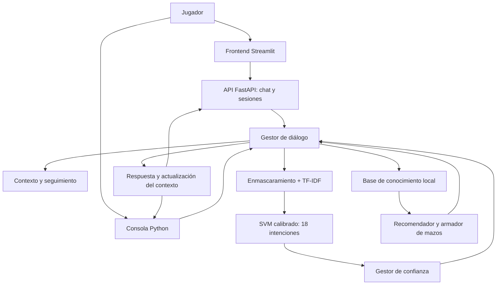

# UMA MUSUME ChatBot v3.8

Asistente conversacional académico en español especializado en **Uma Musume Pretty Derby**, desarrollado con procesamiento de lenguaje natural (NLP), aprendizaje supervisado, reglas de diálogo y una base de conocimiento local.

> **Estado del proyecto (versión preliminar v3.8):** se completaron las etapas de desarrollo **1 a 12**, incluida la integración del frontend Streamlit y las mejoras de mazos, estadísticas, NLP y confianza. **La versión pública 4.0 aún no está cerrada**: falta incorporar la próxima actualización de la base de datos y realizar la **Etapa 13, evaluación integral final**, con pruebas nuevas y revisión humana. El modelo predictivo interno más reciente se identifica como `v4`; este nombre **no implica** que la aplicación esté publicada como versión 4.0.

## 1. Descripción del proyecto

El proyecto busca ayudar a jugadores a consultar mecánicas, personajes, cartas de soporte y estrategias de entrenamiento. El sistema recibe un mensaje, identifica su intención, consulta información local y genera una respuesta mediante reglas y plantillas. Mantiene contexto por sesión para interpretar referencias y preferencias en varios turnos.

El procesamiento de texto utiliza **TF-IDF de palabras y caracteres**, además de **enmascaramiento de entidades** (personajes, escenarios y rarezas). Un **SVM lineal calibrado** clasifica **18 intenciones**; su desempeño se compara experimentalmente con otras configuraciones. El gestor de confianza considera las probabilidades de las principales intenciones y su margen para responder, aclarar o pedir reformulación. No utiliza un modelo generativo externo ni requiere una clave de API comercial.

### Arquitectura general



## 2. Alcance y limitaciones

### Funcionalidades disponibles

- **18 intenciones**, entre ellas información de personajes y cartas, estadísticas, **objetivos de estadísticas**, habilidades, escenarios, herencias, recomendaciones y consultas fuera del dominio.
- Reconocimiento de entidades, manejo de ambigüedad, aclaraciones numeradas y contexto entre turnos; seguimiento de personaje, escenario, distancia, rareza y preferencias F2P.
- Recomendación individual de cartas por compatibilidad de personaje, escenario, distancia, estilo, pista y otras restricciones, con explicaciones basadas en los datos registrados.
- Priorización de cartas con **evidencia estructurada F2P**; F2P no se trata como sinónimo de rareza SR. Manejo de negaciones de SSR y alternativas orientativas SSR → SR.
- **Armador orientativo de hasta seis cartas** por roles de entrenamiento; muestra espacios vacantes si faltan cartas compatibles y no relaja filtros silenciosamente.
- Consulta de objetivos generales de **Speed, Stamina, Power, Guts y Wit** registrados por personaje, sin afirmar que sean metas específicas por escenario.
- Modelo interno `v4` mejorado con enmascaramiento de entidades y n-gramas de caracteres, con una política de confianza ajustada para sus 18 intenciones.
- Tres formas de uso: **interfaz web Streamlit**, **consola** y **API HTTP FastAPI**; sesiones independientes y reinicio de conversación.

### Datos y modelos disponibles

| Recurso | Estado actual |
| --- | --- |
| Intenciones del modelo más reciente | **18** |
| Entrenamiento del modelo interno V4 | **613 ejemplos**: 510 de DBCv3 + 73 de refuerzo + 30 de `objetivos_stats` |
| Datos de prueba heredados | 170 ejemplos de DBCv3 y un conjunto adicional de 68, ya usados en evaluaciones anteriores |
| Prueba focalizada de `objetivos_stats` | 10 ejemplos sintéticos |
| Personajes | 32 |
| Cartas de soporte | 33 |
| Registros de efectos | 53 |
| Registros de conocimiento | 41 |
| Base de conocimiento editable más reciente | `data/source/DBCv4_etapa10.xlsx` |
| Modelos históricos | `original`, `reforzado`, `v3` |
| Modelo interno predeterminado | `v4` → `artifacts/modelo_v4_etapa12.joblib` |

**Importante:** `DBCv4_etapa10.xlsx` corresponde a la versión de la **base de datos** y `--modelo v4` al identificador técnico del **clasificador**. La versión pública del proyecto sigue siendo **v3.8**. La nueva intención se incorpora en archivos suplementarios, sin modificar las hojas de entrenamiento originales del Excel.

### Limitaciones conocidas

- El chatbot está limitado a su catálogo de entidades, clases y conocimientos; puede equivocarse con frases ambiguas, preguntas fuera del dominio o errores ortográficos no contemplados.
- La continuidad conversacional depende de reglas y estados finitos; no equivale a memoria o comprensión ilimitadas.
- Las recomendaciones y mazos son **heurísticos**: no optimizan todas las sinergias, habilidades, estadísticas finales ni probabilidades de victoria.
- No conoce el inventario, nivel real ni recursos del jugador. Las sustituciones SSR → SR son **orientativas por rol**, no equivalencias exactas.
- La clasificación F2P se fundamenta en notas de la base; aún requiere contraste externo. Los objetivos de estadísticas no están desglosados por escenario.
- La regla de exclusión de ciertas cartas homónimas del personaje entrenado permanece pendiente de verificación contra las reglas del juego.
- Las sesiones del servidor se mantienen **en memoria**: expiran tras 30 minutos de inactividad y desaparecen al reiniciar la API. No hay autenticación ni persistencia compartida.
- Las métricas históricas no constituyen una **evaluación final ciega**. La actualización pendiente de la base de datos, la evaluación humana y el cierre académico corresponden a la Etapa 13.

## 3. Requisitos del sistema

| Elemento | Requisito o recomendación |
| --- | --- |
| Sistema operativo | Windows 10/11 recomendado; también puede utilizarse un entorno compatible con Python. |
| Python | **3.11 o posterior** compatible con las dependencias; los artefactos `joblib` requieren cuidado con las versiones instaladas. |
| Entorno de trabajo | Visual Studio Code y PowerShell recomendados en Windows. |
| Backend | `requirements.txt`: NumPy, pandas, scikit-learn **1.8.0**, joblib, openpyxl, FastAPI, Uvicorn y HTTPX. |
| Frontend | `frontend/requirements.txt`: **Streamlit, Requests y Pillow**. |
| Navegador | Necesario para Streamlit y opcional para Swagger UI. |
| Hardware | CPU convencional; no se requiere GPU. No se han medido mínimos oficiales de memoria. |
| Internet | Para instalar dependencias; el procesamiento local no requiere conectividad externa. |

No se necesita MySQL ni otro servidor de base de datos: el proyecto utiliza CSV, JSON y Excel locales. **No cargues modelos `.joblib` de fuentes desconocidas.**

## 4. Instalación y ejecución

Todos los comandos se ejecutan **desde la raíz del proyecto**, donde se encuentran `src/`, `frontend/`, `requirements.txt` y este README.

### 4.1. Preparar Python y el entorno virtual (Windows / PowerShell)

1. Extrae el proyecto y abre su carpeta en VS Code.
2. Comprueba Python y crea el entorno virtual (solo la primera vez):

```powershell
py -3.11 --version
py -3.11 -m venv .venv
.\.venv\Scripts\Activate.ps1
```

Si PowerShell bloquea la activación, ejecuta esto **en la terminal actual** y vuelve a activarlo:

```powershell
Set-ExecutionPolicy -Scope Process -ExecutionPolicy Bypass
.\.venv\Scripts\Activate.ps1
```

3. Instala las dependencias del backend **y del frontend**:

```powershell
python -m pip install --upgrade pip
python -m pip install -r requirements.txt
python -m pip install -r frontend/requirements.txt
```

4. En VS Code selecciona `.venv\Scripts\python.exe` usando **Python: Select Interpreter**. Activa `.venv` en cada terminal nueva.

### 4.2. Ejecutar la aplicación web completa (opción recomendada)

Abre **dos terminales** en la raíz del proyecto, ambas con el entorno virtual activado.

**Terminal 1 — Backend FastAPI**

```powershell
$env:UMABOT_MODELO = "v4"
python -m uvicorn src.api.app:app --reload --host 127.0.0.1 --port 8000
```

**Terminal 2 — Frontend Streamlit**

```powershell
python -m streamlit run frontend/app_frontend.py
```

Abre la dirección que muestre Streamlit, normalmente **http://localhost:8501**. La API se ejecuta en **http://127.0.0.1:8000** y su documentación interactiva está en **http://127.0.0.1:8000/docs**.

El frontend de esta entrega apunta a `API_URL = "http://127.0.0.1:8000"` en `frontend/app_frontend.py`. Si frontend y backend están en computadoras distintas, adapta esa dirección. Mantén ambos procesos en ejecución; para detenerlos utiliza `Ctrl+C` en sus terminales.

**Prueba recomendada en una misma sesión:**

```text
Háblame de Gold Ship
Ármame un mazo para ella
¿Y para carreras largas y F2P?
¿Y si no tengo ninguna SSR?
¿Cuáles son las estadísticas ideales?
¿Y para URA Finale?
Ahora háblame de Oguri Cap
```

El frontend conserva el `session_id` y permite reiniciar el chat. Ante una aclaración del bot, responde con la opción indicada o reformula el mensaje.

### 4.3. Ejecutar únicamente la consola

```powershell
python -m src.chat_console
```

**Por defecto utiliza el modelo interno V4 de la Etapa 12.** Para realizar comparaciones históricas:

```powershell
python -m src.chat_console --modelo v3
python -m src.chat_console --modelo reforzado
python -m src.chat_console --modelo original
```

Los modelos ya vienen entrenados en `artifacts/`, por lo que **no necesitas entrenarlos** para ejecutar el chat. Usa `/reiniciar` para borrar el contexto y `salir` para terminar la sesión.

### 4.4. Probar directamente la API (opcional)

Con el backend activo, abre `http://127.0.0.1:8000/docs` y utiliza **Try it out**.

| Método | Ruta | Función |
| --- | --- | --- |
| `GET` | `/api/health` | Estado del servicio y modelo activo. |
| `POST` | `/api/chat` | Enviar mensaje y continuar una sesión. |
| `POST` | `/api/reset` | Reiniciar el contexto de una sesión existente. |

Primera petición:

```json
{"mensaje":"Háblame de Gold Ship"}
```

Después, reutiliza el `session_id` que devuelva el servidor:

```json
{"session_id":"UUID_RECIBIDO","mensaje":"Ármame un mazo para ella"}
```

Para reiniciar:

```json
{"session_id":"UUID_RECIBIDO"}
```

Las respuestas del chat incluyen `respuesta`, `intencion`, `confianza`, `fuente`, `contexto` y, cuando aplica, `diagnostico_confianza`. La configuración CORS se puede modificar mediante `UMABOT_CORS_ORIGINS`, separando los orígenes con comas. Para los detalles del contrato consulta [Etapa 4 — API y frontend](docs/ETAPA_4_API_FRONTEND.md).

### 4.5. Entrenamiento y actualización de datos (opcional)

La base actual **ya está exportada**. Si necesitas regenerar los CSV y JSON desde el Excel (por ejemplo, cuando llegue una nueva base), **haz primero una copia de seguridad** y revisa las rutas y nuevas columnas:

```powershell
python scripts/export_from_xlsx.py
```

Para reproducir los experimentos de entrenamiento históricos y el modelo interno más reciente:

```powershell
# Modelo V3 anterior (17 intenciones)
python -m src.models.train_v3

# Experimento de la nueva intención (18 intenciones)
python -m src.models.train_v4_intenciones

# Modelo más reciente: NLP de palabras + caracteres + entidades
python -m src.models.train_v4_nlp
```

Los ejemplos adicionales de `objetivos_stats` están en `data/raw/objetivos_stats_train.csv` y `data/raw/objetivos_stats_test.csv`. **No uses los conjuntos de prueba históricos para seleccionar ajustes nuevos**. No se recomienda reentrenar antes de recibir y validar la actualización pendiente del equipo.

### 4.6. Ejecutar las pruebas

Pruebas unitarias y de integración:

```powershell
python -m unittest discover -s tests -p "test_*.py"
```

Pruebas conversacionales y HTTP:

```powershell
python tests/run_conversation_tests.py --modelo v4
$env:UMABOT_MODELO = "v4"
python tests/test_api.py
```

Pruebas específicas de las últimas etapas:

```powershell
python tests/test_etapa8_estado_filtros.py
python tests/test_etapa9_seguimientos.py
python tests/test_etapa10_f2p.py
python tests/test_etapa11_mazos.py
python tests/test_etapa12_nlp.py
```

Las pruebas HTTP usan el cliente de pruebas de FastAPI y no necesitan un servidor Uvicorn en ejecución. Los resultados históricos de clasificación y las evidencias se encuentran en `data/processed/`. También puedes consultar la evaluación diagnóstica previa (Etapa 6), que **no representa todavía el cierre de v4.0**.

## 5. Estructura del proyecto

```text
UMA-MUSUME-CHATBOT/
├── artifacts/                    # Modelos original, reforzado, V3 y V4
├── data/
│   ├── raw/                     # Datasets, refuerzo y objetivos_stats
│   ├── game/                    # Personajes, cartas, efectos, JSON de intenciones
│   ├── challenge/               # Evaluación adicional histórica
│   ├── processed/               # Métricas, resultados y políticas de confianza
│   ├── source/                  # Excel DBCv3 y DBCv4_etapa10
│   ├── versions/                # Versiones históricas de los datos
│   └── legacy/                  # Datos originales del equipo
├── docs/                        # Documentación detallada de cada etapa
├── frontend/
│   ├── app_frontend.py          # Interfaz Streamlit
│   ├── avatar.png               # Recurso gráfico
│   └── requirements.txt         # Dependencias visuales
├── notebooks/                   # Experimentación académica
├── scripts/                     # Exportación de Excel
├── src/
│   ├── api/                     # FastAPI y sesiones
│   ├── conversation/            # Diálogo, contexto, recomendador y mazos
│   ├── evaluation/              # Experimentos, métricas, evaluación
│   ├── models/                  # Entrenamiento y predictor
│   ├── preprocessing/           # TF-IDF y enmascaramiento de entidades
│   ├── utils/                   # Carga de datos
│   └── chat_console.py          # Consola
├── tests/                       # Pruebas automatizadas
├── .gitignore
├── requirements.txt
└── README.md
```

## 6. Etapas de desarrollo

La numeración es **continua desde el inicio del proyecto**. Las etapas 7 a 12 representan el desarrollo en preparación de v4.0, aunque el proyecto se distribuye por ahora como **v3.8**.

### Etapa 1 — Integración del NLP y el gestor conversacional

Se conectó TF-IDF y SVM calibrado con el gestor de diálogo, contexto y base de conocimiento. Se organizó el código y se habilitó el chat por consola. Referencias: [dataset](docs/DATASET.md), `src/models/train.py` y `src/models/predictor_adapter.py`.

### Etapa 2 — Diagnóstico y evaluación del NLP

Se compararon clasificadores con validación cruzada, se auditaron duplicados y se estudiaron matrices de confusión y errores. [Documentación de la Etapa 2](docs/ETAPA_2_DIAGNOSTICO.md).

### Etapa 3 — Refuerzo y evaluación adicional

Se sumaron 73 ejemplos de entrenamiento y se creó un conjunto adicional de 68 preguntas para analizar errores y registrar una versión reforzada. [Documentación de la Etapa 3](docs/ETAPA_3_REFUERZO_EVALUACION.md).

### Etapa 4 — Servicio HTTP FastAPI

Se incorporaron `/api/health`, `/api/chat` y `/api/reset`, sesiones aisladas, validación y pruebas HTTP. [Documentación de la Etapa 4](docs/ETAPA_4_API_FRONTEND.md).

### Etapa 5 — Base DBCv3, confianza, contexto y recomendaciones

Se actualizó el dataset, se entrenó V3 con 583 ejemplos, se incorporaron decisiones por confianza y margen, aclaraciones, persistencia de preferencias y un recomendador por compatibilidad. Documentación detallada: [5.1 Base y entrenamiento](docs/ETAPA_5_1_DBCV3.md), [5.2 Confianza](docs/ETAPA_5_2_CONFIANZA.md), [5.3 Contexto](docs/ETAPA_5_3_CONTEXTO.md) y [5.4 Recomendaciones](docs/ETAPA_5_4_RECOMENDACIONES.md).

### Etapa 6 — Evaluación diagnóstica del sistema

Se incorporaron herramientas para medir clasificación, confianza, conversaciones, API y tiempos de respuesta. La rúbrica de calidad humana quedó pendiente; **este diagnóstico no constituye la evaluación integral final de v4.0**. [Documentación de la Etapa 6](docs/ETAPA_6_EVALUACION_INTEGRAL.md).

### Etapa 7 — Integración del frontend Streamlit

Se integró la interfaz visual del equipo y su avatar, se prepararon dependencias adicionales y se validó el contrato con FastAPI. [Plan de integración y desarrollo](docs/VERSION_4_0_PLAN.md).

### Etapa 8 — Corrección de estado y filtros

Se impidió que «mazo» se interpretara como estadística, se corrigieron filtros que quedaban heredados entre personajes, se redujo la confusión entre carta y personaje homónimos y se protegió el contexto ante búsquedas fallidas. [Documentación de la Etapa 8](docs/ETAPA_8_ESTADO_FILTROS.md).

### Etapa 9 — Seguimientos, negaciones y sustituciones

Se mejoraron los cambios contextuales de escenario y rareza; se distinguió entre no tener ninguna SSR y no tener todas, y se ofrecieron sustitutos orientativos SR por rol. [Documentación de la Etapa 9](docs/ETAPA_9_SEGUIMIENTOS_NEGACIONES.md).

### Etapa 10 — Datos F2P estructurados

Se creó `DBCv4_etapa10.xlsx`, con los campos `f2p` y `f2p_fuente`, separando disponibilidad F2P de rareza SR. Se mejoró la prioridad de las cartas documentadas y el diagnóstico de filtros sin resultados. [Documentación de la Etapa 10](docs/ETAPA_10_DATOS_F2P.md).

### Etapa 11 — Armador de mazos y objetivos de estadísticas

Se incorporó un armador orientativo de seis espacios por roles, conservando restricciones. Se añadió `objetivos_stats` como **intención número 18**, con 30 ejemplos de entrenamiento y 10 de comprobación, y un modelo exploratorio de 18 clases. [Documentación de la Etapa 11](docs/ETAPA_11_MAZOS_OBJETIVOS.md).

### Etapa 12 — Mejoras de NLP y gestión de confianza

Se compararon representaciones basadas en palabras, caracteres y enmascaramiento de entidades. La variante combinada fue seleccionada y calibrada, y se ajustaron umbrales de aceptación específicos para el modelo V4. Consola y API ahora utilizan **`v4` por defecto**, con posibilidad de seleccionar modelos históricos. Se corrigieron regresiones de conversación y se conservaron el frontend y los endpoints. [Documentación de la Etapa 12](docs/ETAPA_12_NLP_CONFIANZA.md).

### Etapa 13 — Evaluación final y cierre de v4.0 (pendiente)

**No iniciada.** Se realizará después de recibir, auditar e integrar la actualización de datos del equipo. Deberá incluir una evaluación nueva de las **18 intenciones**, conversaciones de varios turnos, comprobación de mazos y recomendaciones, pruebas con Streamlit, valoración humana y documentación de resultados. Solo tras completar y revisar estas evidencias se considerará el cierre de la versión 4.0.

## 7. Historial de versiones

La numeración de publicación describe el **estado del proyecto**; los identificadores `original`, `reforzado`, `v3` y `v4` son nombres de **modelos predictivos**, no equivalen necesariamente a versiones públicas independientes.

| Versión del proyecto | Avances respecto a la anterior |
| --- | --- |
| **v1.0** | Primera integración del clasificador supervisado, gestor conversacional y consola. |
| **v2.0** | Refuerzo de datos, pruebas adicionales y servicio FastAPI con sesiones. |
| **v3.0** | Base DBCv3, confianza, contexto y recomendaciones personalizadas. |
| **v3.7** | Integración del frontend, correcciones de contexto, F2P estructurado y armador de mazos con objetivos de estadísticas. |
| **v3.8 — Actual** | Mejora de NLP mediante enmascaramiento y n-gramas de caracteres, nuevo SVM calibrado de 18 intenciones, ajuste de confianza y activación del modelo interno V4 por defecto. |
| **v4.0 — Pendiente** | Incorporación de la nueva base y evaluación integral final; todavía no se declara publicada. |

### Modelos disponibles para experimentación

| Argumento | Artefacto | Observación |
| --- | --- | --- |
| `original` | `artifacts/mejor_modelo.joblib` | Baseline histórico. |
| `reforzado` | `artifacts/modelo_reforzado_etapa3.joblib` | Refuerzo inicial. |
| `v3` | `artifacts/modelo_v3.joblib` | 17 intenciones y política de confianza V3. |
| **`v4`** | `artifacts/modelo_v4_etapa12.joblib` | **18 intenciones; modelo predeterminado de la aplicación v3.8.** |

Se conserva también `artifacts/modelo_v4_etapa11.joblib` para reproducir el experimento exploratorio de la Etapa 11.

## 8. Resultados y evaluación disponible

### Comparación de representaciones de NLP (Etapa 12)

Validación cruzada estratificada de cinco particiones sobre los **613 ejemplos de entrenamiento**:

| Variante | Accuracy fuera de partición | F1 macro fuera de partición |
| --- | ---: | ---: |
| TF-IDF de palabras (1–2) | 76.02 % | 75.44 % |
| Palabras + caracteres (3–5) | 79.12 % | 78.66 % |
| **Enmascaramiento + palabras + caracteres** | **81.40 %** | **81.33 %** |

En el ajuste de confianza del modelo V4 se seleccionaron: **confianza mínima 0.50**, **margen mínimo 0.25** y límite inferior heurístico **0.25** para reformulación. Durante la selección se observó **65.74 % de cobertura directa** y **93.55 % de exactitud entre aceptadas**; al tratarse de los datos empleados para elegir la política, **no son estimaciones ciegas**.

### Comprobaciones históricas y funcionales

La Etapa 12 registró en conjuntos **ya utilizados previamente** una exactitud de **95.29 %** sobre 170 preguntas de DBCv3, **86.76 %** sobre 68 preguntas adicionales y **80.00 %** sobre diez ejemplos focalizados de `objetivos_stats`. **Estas cifras no deben presentarse como evaluación final independiente.**

| Pruebas registradas en la Etapa 12 | Resultado |
| --- | ---: |
| Nuevas pruebas de NLP y confianza | 8/8 |
| Pruebas unitarias y de integración | 65/65 |
| Turnos conversacionales originales | 34/34 |
| Grupos de pruebas HTTP | 4/4 |

Las pruebas funcionales comprueban escenarios concretos; **no demuestran por sí solas la calidad estratégica de las recomendaciones ni la generalización a usuarios reales**. Metodología y evidencias: [Etapa 12](docs/ETAPA_12_NLP_CONFIANZA.md) y `data/processed/etapa12/`.

## 9. Trabajo pendiente antes de publicar v4.0

1. Recibir la nueva base de datos, verificar su esquema, procedencia, consistencia y compatibilidad con el catálogo e intenciones actuales.
2. Actualizar los archivos derivados, preservar un respaldo y decidir si es necesario reentrenar y recalibrar la política de confianza.
3. Definir y reservar **nuevas** preguntas y conversaciones de evaluación para las 18 intenciones, evitando solapamiento y ajustes sobre datos de prueba.
4. Evaluar clasificación, detección fuera del dominio, gestión de confianza, seguimiento contextual, mazos, recomendaciones y experiencia de uso desde Streamlit.
5. Completar la evaluación humana y el reporte de cierre. **Hasta entonces, el proyecto se identifica como v3.8.**

## 10. Documentación, procedencia y aviso

Toda la documentación detallada se encuentra en [`docs/`](docs/). Consulta [`docs/DATASET.md`](docs/DATASET.md) y los documentos vinculados en cada etapa para revisar metodología, decisiones y limitaciones. Los resultados experimentales se conservan en `data/processed/` cuando corresponda.

Proyecto académico no oficial, sin afiliación con los desarrolladores de **Uma Musume Pretty Derby**. La información del catálogo debe contrastarse con las reglas y actualizaciones del juego antes de utilizarla como referencia definitiva.
