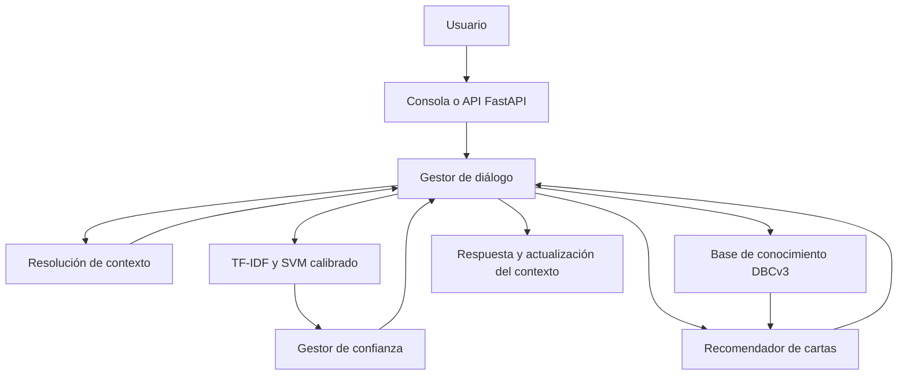

# UMA MUSUME ChatBot v3.6

Asistente conversacional académico en español especializado en **Uma Musume Pretty Derby**, desarrollado mediante procesamiento de lenguaje natural (NLP), aprendizaje supervisado y un sistema de recomendaciones basado en conocimiento.

**Estado actual:** Etapas 1 a 5 completadas. Pendiente: evaluación integral del chatbot (Etapa 6).

## 1. Descripción del proyecto

El proyecto tiene como objetivo facilitar la consulta de información sobre las mecánicas del videojuego y orientar al jugador durante el entrenamiento de personajes. El asistente identifica la intención de cada mensaje, recupera información de una base de conocimiento local y construye respuestas mediante reglas y plantillas. También mantiene el contexto para interpretar preguntas relacionadas a lo largo de una conversación.

El sistema emplea TF-IDF para representar el texto y una máquina de vectores de soporte lineal (SVM) con calibración de probabilidades para clasificar intenciones. Se comparó su desempeño con regresión logística mediante validación cruzada. No utiliza un modelo generativo externo ni necesita una clave de API comercial.

### Arquitectura



## 2. Alcance y limitaciones

### Funcionalidades disponibles

- Clasificación de 17 intenciones en español, incluyendo consultas sobre personajes, cartas, estadísticas, habilidades, herencias, escenarios, recompensas, saludos y despedidas.
- Consulta de fichas de personajes, información de cartas de soporte y mecánicas registradas en DBCv3.
- Gestión de incertidumbre mediante las tres intenciones más probables (Top-3), confianza y margen de clasificación.
- Aclaraciones específicas y selección de alternativas por número; conservación de entidades y preferencias entre turnos.
- Recomendaciones de cartas según personaje, distancia, estilo, pista, escenario, estadística y rareza; exclusión explícita de SSR y priorización de evidencia F2P cuando se solicita.
- Justificación de recomendaciones con datos del catálogo y paginación sin repetir opciones dentro del mismo ranking.
- Interacción por consola y API HTTP con sesiones independientes y reinicio de conversación.

### Base de datos activa

| Elemento | Cantidad |
| --- | ---: |
| Intenciones | 17 |
| Ejemplos de entrenamiento DBCv3 | 510 |
| Ejemplos adicionales de refuerzo | 73 |
| Total de entrenamiento del modelo V3 seleccionado | 583 |
| Ejemplos de prueba DBCv3 | 170 |
| Personajes | 32 |
| Cartas de soporte | 33 |
| Registros de efectos de cartas | 53 |
| Registros de conocimiento | 41 |

La fuente activa es `data/source/DBCv3.xlsx`. Los datos exportados se encuentran en `data/raw/` y `data/game/`. La versión anterior se conserva en `data/versions/dbc_v2/` para reproducir los experimentos históricos.

### Limitaciones actuales

- El asistente está restringido a las intenciones y conocimientos disponibles; puede confundir consultas fuera del dominio o mensajes ambiguos, incluso con confianza alta.
- La memoria es limitada y las referencias se resuelven mediante reglas; no existe comprensión ilimitada del lenguaje ni garantía de mantener cualquier conversación.
- Los datos del juego no se actualizan automáticamente ni se han verificado en su totalidad contra la versión vigente del videojuego.
- El ranking de cartas es heurístico, no predice la probabilidad de ganar y no optimiza un mazo completo ni sus sinergias.
- No conoce el inventario, niveles reales ni recursos del jugador; F2P no equivale a SR y la evidencia de disponibilidad gratuita es incompleta. Los bonos mostrados corresponden al máximo nivel registrado o al mayor disponible.
- Las sesiones HTTP se mantienen en memoria: expiran tras 30 minutos de inactividad y se pierden al reiniciar el servidor. La API está orientada a demostraciones locales, sin autenticación ni persistencia distribuida.
- Las pruebas actuales verifican funcionalidades concretas; aún falta una evaluación integral con conversaciones nuevas y valoración humana de la calidad de las respuestas.

## 3. Requisitos del sistema

| Requisito | Descripción |
| --- | --- |
| Sistema operativo | Windows 10/11 (entorno de trabajo recomendado para el equipo). |
| Python | 3.11 recomendado; las verificaciones de V3 se realizaron con Python 3.13.5. |
| Editor | Visual Studio Code recomendado; puede utilizarse cualquier editor o terminal. |
| Dependencias | Instaladas desde `requirements.txt`, especialmente scikit-learn 1.8.0. |
| Navegador | Necesario únicamente para probar Swagger UI o utilizar el frontend. |
| Conexión a Internet | Para descargar dependencias; no se requiere durante la ejecución local con los datos y modelos disponibles. |
| Hardware | CPU convencional; no se requiere GPU. No se han medido requisitos mínimos de RAM ni almacenamiento. |

Las dependencias principales son NumPy, pandas, scikit-learn, joblib, openpyxl, FastAPI, Uvicorn y HTTPX. No es necesario instalar un servidor de bases de datos: el proyecto utiliza CSV, JSON y Excel como fuentes locales.

## 4. Instalación y ejecución

Todos los comandos siguientes se ejecutan en PowerShell desde la carpeta raíz del proyecto (la que contiene `README.md`, `requirements.txt` y `src/`).

### 4.1. Preparar el entorno

1. Descargar o extraer el proyecto y abrir su carpeta en VS Code.
2. Abrir una terminal PowerShell y verificar Python:

```powershell
py -3.11 --version
```

3. Crear y activar un entorno virtual (solo es necesario crearlo una vez):

```powershell
py -3.11 -m venv .venv
.\.venv\Scripts\Activate.ps1
```

Si PowerShell bloquea la activación, permitirla únicamente en la terminal actual y repetirla:

```powershell
Set-ExecutionPolicy -Scope Process -ExecutionPolicy Bypass
.\.venv\Scripts\Activate.ps1
```

4. Instalar las dependencias:

```powershell
python -m pip install --upgrade pip
python -m pip install -r requirements.txt
```

En VS Code se recomienda seleccionar el intérprete `.venv\Scripts\python.exe` mediante **Python: Select Interpreter**. En cada terminal nueva se debe activar el entorno nuevamente.

### 4.2. Ejecutar el chatbot por consola

Los modelos entrenados están incluidos en `artifacts/`. No es necesario volver a entrenarlos para usar el chatbot.

```powershell
python -m src.chat_console --modelo v3
```

Escribir los mensajes cuando aparezca `Tú:`. Para comprobar el contexto, introducir consecutivamente:

```text
Háblame de Gold Ship
¿Qué cartas me recomiendas para ella?
Para largas y que sean F2P
¿Y si no tengo SSR?
Dame más opciones
```

El chatbot muestra la respuesta, la intención, la confianza y la fuente de resolución. Ante una aclaración pendiente, seleccionar una de las opciones presentadas o reformular la pregunta.

- `/reiniciar`: borra el contexto de la conversación actual.
- `salir`: finaliza el chatbot.

**Importante:** especificar `--modelo v3` para utilizar la versión actual. Si se omite, la consola utiliza el modelo original por compatibilidad histórica.

### 4.3. Ejecutar la API para el frontend

```powershell
$env:UMABOT_MODELO = "v3"
python -m uvicorn src.api.app:app --reload --host 127.0.0.1 --port 8000
```

Mantener esta terminal abierta mientras se utiliza la API. Abrir [Swagger UI](http://127.0.0.1:8000/docs) para realizar peticiones desde el navegador. Para detener el servidor, presionar `Ctrl+C`.

| Método | Endpoint | Propósito |
| --- | --- | --- |
| GET | `/api/health` | Comprobar el estado y modelo activo. |
| POST | `/api/chat` | Enviar un mensaje y recibir la respuesta. |
| POST | `/api/reset` | Reiniciar una sesión existente. |

En Swagger UI, abrir `POST /api/chat`, presionar **Try it out**, introducir el siguiente JSON y pulsar **Execute**:

```json
{"mensaje": "Háblame de Gold Ship"}
```

Copiar el `session_id` devuelto y utilizarlo en las siguientes peticiones:

```json
{"session_id": "UUID_RECIBIDO", "mensaje": "¿Qué cartas me recomiendas para ella?"}
```

Para reiniciar, enviar a `POST /api/reset`:

```json
{"session_id": "UUID_RECIBIDO"}
```

El frontend puede utilizar `respuesta`, `intencion`, `confianza`, `fuente`, `contexto` y `diagnostico_confianza`. Este último puede ser nulo cuando la respuesta se resuelve mediante reglas. La API acepta por defecto orígenes `http://localhost:3000` y `http://127.0.0.1:3000`; otros orígenes locales pueden configurarse con `UMABOT_CORS_ORIGINS` (lista separada por comas). Sin `UMABOT_MODELO`, la API carga el modelo reforzado anterior, no V3.

Consultar el [contrato HTTP y ejemplo de integración Next.js](docs/ETAPA_4_API_FRONTEND.md) y las ampliaciones de confianza y contexto en la documentación de la Etapa 5. El frontend se desarrolla por separado; este repositorio proporciona el servicio y la consola.

### 4.4. Actualizar los datos y reentrenar (opcional)

Realizar este procedimiento únicamente si se modifica el Excel o se desea reproducir el entrenamiento. Respaldar los datos y artefactos antes de regenerarlos.

```powershell
python scripts/export_from_xlsx.py
python -m src.models.train_v3
```

El exportador valida y genera los archivos locales. El entrenamiento compara V3 base y V3 reforzado mediante validación cruzada y guarda el modelo seleccionado en `artifacts/modelo_v3.joblib`. Los scripts históricos utilizan la copia de los datos V2. No utilizar conjuntos de prueba ya evaluados para seleccionar nuevos cambios.

Cargar archivos `.joblib` únicamente de fuentes confiables. Si se presentan incompatibilidades al cargar un modelo, verificar la versión de scikit-learn y, si es necesario, reentrenar en el entorno local.

### 4.5. Ejecutar las pruebas

```powershell
python tests/run_conversation_tests.py --modelo v3
python tests/test_confidence.py
python tests/test_context.py
python tests/test_recommendations.py
$env:UMABOT_MODELO = "v3"
python tests/test_api.py
```

Las pruebas HTTP utilizan el cliente de pruebas de FastAPI, por lo que no requieren iniciar Uvicorn previamente. Las evidencias de las últimas ejecuciones se conservan en `data/processed/etapa54/`.

## 5. Estructura del proyecto

```text
UMA-MUSUME-CHATBOT/
├── artifacts/           # Tres modelos entrenados
├── data/
│   ├── raw/             # Entrenamiento, prueba y refuerzo
│   ├── game/            # Catálogo y plantillas de respuesta
│   ├── challenge/       # Evaluación adicional de la Etapa 3
│   ├── processed/       # Métricas, errores y pruebas
│   ├── source/          # Archivos Excel de origen
│   ├── versions/        # Respaldo de DBCv2
│   └── legacy/          # Datos históricos del compañero
├── docs/                # Documentación técnica por etapa
├── notebooks/           # Espacio para experimentación
├── scripts/             # Exportación de Excel
├── src/
│   ├── api/             # FastAPI y sesiones
│   ├── conversation/    # Diálogo, confianza, contexto y recomendación
│   ├── evaluation/      # Diagnósticos y métricas
│   ├── models/          # Entrenamiento y adaptador predictivo
│   ├── preprocessing/   # Vectorización de texto
│   ├── utils/           # Carga de datos
│   └── chat_console.py  # Interfaz de consola
├── tests/               # Pruebas automáticas
├── requirements.txt
└── README.md
```

## 6. Etapas de desarrollo

### Etapa 1 — Integración del NLP y gestor conversacional

Se unificó el clasificador TF-IDF + SVM calibrado con el gestor de diálogo, contexto y conocimiento desarrollado por el equipo. Se sustituyó el predictor provisional mediante `predictor_adapter.py`, se organizaron los datos y se habilitó una consola funcional. El modelo inicial se entrenó con 425 ejemplos y se comprobó con las 34 pruebas conversacionales originales.

Referencias: [documentación del dataset](docs/DATASET.md), `src/models/train.py`, `src/models/predictor_adapter.py` y `src/chat_console.py`. No existe un informe independiente de Etapa 1 en la carpeta `docs/` de esta entrega.

### Etapa 2 — Diagnóstico y evaluación del NLP

Se compararon regresión logística, SVM lineal y SVM calibrado mediante validación cruzada, se analizaron errores y matrices de confusión y se auditaron duplicados y similitudes entre datasets. También se estudió la relación entre cobertura y exactitud al aplicar distintos umbrales de confianza. Se conservaron el modelo y la política desplegados.

Documentación: [Etapa 2 — Diagnóstico reproducible](docs/ETAPA_2_DIAGNOSTICO.md).

### Etapa 3 — Refuerzo del entrenamiento y nueva evaluación

Se añadieron 73 ejemplos etiquetados para reforzar las intenciones problemáticas, generando un segundo modelo con 498 ejemplos de entrenamiento. Se prepararon 68 preguntas adicionales, cuatro por intención, separadas del entrenamiento para evaluar la nueva variante. El refuerzo mejoró el F1 macro de validación cruzada de 70.31 % a 73.39 %; las preguntas adicionales produjeron 82.35 % de exactitud. Se conservaron los modelos y datos anteriores.

Documentación: [Etapa 3 — Refuerzo y evaluación](docs/ETAPA_3_REFUERZO_EVALUACION.md).

### Etapa 4 — API para integración con el frontend

Se incorporó FastAPI para comunicar el chatbot con interfaces externas mediante HTTP. Se implementaron endpoints de salud, conversación y reinicio, sesiones aisladas por UUID, validación de entradas y configuración CORS. Se agregaron pruebas de integración y una guía para el frontend.

Documentación: [Etapa 4 — API y frontend](docs/ETAPA_4_API_FRONTEND.md).

### Etapa 5 — Actualización V3, confianza, contexto y calidad de respuestas

Esta etapa consolidó el sistema actual. Se integró DBCv3, se corrigió el exportador de Excel y se compararon las variantes de 510 y 583 ejemplos, seleccionando el SVM calibrado reforzado por su F1 macro en validación cruzada. Después se implementó el gestor de confianza, que acepta clasificaciones con probabilidad estimada de al menos 45 % y margen mínimo de 20 puntos porcentuales; ante incertidumbre solicita aclarar o reformular. El límite de 25 % para distinguir ambas acciones es heurístico.

El gestor de contexto se amplió para recordar preferencias, recuperar referencias implícitas, resolver selecciones pendientes y permitir cambios de tema. Finalmente, se incorporó un recomendador que utiliza aptitudes y filtros para ordenar cartas, explica sus beneficios y conserva las restricciones al solicitar más opciones. Se documentaron en español los módulos y funciones nuevos o modificados durante estas mejoras.

Documentación detallada de los componentes de esta etapa:

- [Actualización DBCv3 y entrenamiento](docs/ETAPA_5_1_DBCV3.md).
- [Gestor de confianza](docs/ETAPA_5_2_CONFIANZA.md).
- [Contexto conversacional avanzado](docs/ETAPA_5_3_CONTEXTO.md).
- [Personalización de recomendaciones](docs/ETAPA_5_4_RECOMENDACIONES.md).

### Etapa 6: evaluación integral (experimental)

Se incorporó un evaluador reproducible para clasificación, confianza, conversaciones,
recomendaciones y API sin modificar los modelos ni los datos de entrenamiento.

```powershell
$env:UMABOT_MODELO = "v3"
python -m src.evaluation.evaluacion_integral --modelo v3 --peticiones 25
python -m unittest discover -s tests -p 'test_evaluacion_integral.py'
```

Resultados: [`data/processed/etapa6/v3/`](data/processed/etapa6/v3/).
Metodología y limitaciones: [`docs/ETAPA_6_EVALUACION_INTEGRAL.md`](docs/ETAPA_6_EVALUACION_INTEGRAL.md).
Los conjuntos y conversaciones de esta etapa no son datos ciegos nuevos; la
evaluación humana de calidad debe completarse antes de declarar validada la utilidad.

### Etapa 7: Integración Streamlit (inicio del plan v4.0)

El frontend entregado por el equipo se encuentra en `frontend/app_frontend.py`. La consola y la API utilizan el modelo V3 por defecto. Para instalar el frontend y arrancar ambos servicios, consulta [Plan e integración v4.0](docs/VERSION_4_0_PLAN.md).

### Etapa 8 — Corrección de estado y filtros (desarrollo v4.0)

Se corrigió el error por el término «mazo» al interpretarse como estadística,
la persistencia de restricciones al cambiar de personaje, la asignación
accidental de cartas homónimas y el guardado de consultas sin resultados.
El recomendador sigue generando listas de cartas, no mazos optimizados.

```powershell
python tests/test_etapa8_estado_filtros.py
python tests/run_conversation_tests.py --modelo v3
```

Detalles, pruebas y limitaciones: [`docs/ETAPA_8_ESTADO_FILTROS.md`](docs/ETAPA_8_ESTADO_FILTROS.md).

### Etapa 9 — Seguimientos, negaciones, rarezas y sustituciones (v4.0)

Se corrigieron las continuaciones de escenario y rareza en preguntas breves; ahora
las negaciones de SSR distinguen entre **no tener ninguna** y **no tener todas**.
Las solicitudes de alternativas proponen pares orientativos SSR→SR por rol y
no inventan qué cartas posee el jugador. «Háblame de Gold Ship» se reconoce
como una consulta nueva.

```powershell
python tests/test_etapa9_seguimientos.py
python -m unittest discover -s tests -p "test_*.py"
python tests/run_conversation_tests.py --modelo v3
```

Metodología, cambios y limitaciones: [`docs/ETAPA_9_SEGUIMIENTOS_NEGACIONES.md`](docs/ETAPA_9_SEGUIMIENTOS_NEGACIONES.md).

### Etapa 10 — Datos estructurados y recomendaciones F2P (v4.0)

La disponibilidad F2P ya no se infiere de buscar literalmente `f2p` en las notas:
la fuente activa `data/source/DBCv4_etapa10.xlsx` registra `f2p` y
`f2p_fuente` en la hoja `Cards`, separando **rareza** de **accesibilidad**.
Se conservó DBCv3 como respaldo, sin reentrenar el clasificador V3.

Cuando el jugador solicita F2P, las seis cartas con evidencia positiva
registrada se priorizan frente a cartas de disponibilidad desconocida.
`sin_ssr` y la rareza explícita continúan siendo restricciones estrictas.
Ahora la rareza desempata cuando compatibilidad y bonos coinciden. Los
mensajes sin resultados explican sus filtros, sin eliminar restricciones.

```powershell
python scripts/export_from_xlsx.py
python tests/test_etapa10_f2p.py
python -m unittest discover -s tests -p "test_*.py"
python tests/run_conversation_tests.py --modelo v3
```

Consulta [`docs/ETAPA_10_DATOS_F2P.md`](docs/ETAPA_10_DATOS_F2P.md).
La clasificación F2P procede de notas de DBCv3 y no equivale a una
verificación actual de disponibilidad; la exclusión de cartas del propio
personaje sigue pendiente de contrastación con fuentes del juego.


## 7. Versiones del proyecto

La siguiente numeración identifica las tres generaciones de clasificadores conservadas en el proyecto y resume sus avances acumulados en desarrollo. No son etiquetas Git verificadas ni tres copias independientes de la aplicación: los tres modelos utilizan actualmente DBCv3 y el código conversacional compartido. La política nueva de confianza se activa con V3.

| Versión | Avances respecto a la anterior |
| --- | --- |
| **v1.0 — Original** | Primera versión funcional: integración de TF-IDF y SVM calibrado con el gestor de diálogo y base de conocimiento; ejecución por consola. |
| **v2.0 — Reforzada** | Se añadieron 73 ejemplos de refuerzo, diagnósticos reproducibles, evaluación adicional y API HTTP con sesiones independientes. |
| **v3.0 — Actual** | Se integró DBCv3 y se reentrenó con 583 ejemplos; se incorporaron confianza por margen, aclaraciones pendientes, contexto avanzado y recomendaciones personalizadas y justificadas. |

Para comparar los clasificadores desde la consola:

| Versión | Argumento `--modelo` | Artefacto |
| --- | --- | --- |
| v1.0 | `original` | `artifacts/mejor_modelo.joblib` |
| v2.0 | `reforzado` | `artifacts/modelo_reforzado_etapa3.joblib` |
| v3.0 | `v3` | `artifacts/modelo_v3.joblib` |

## 8. Resultados y estado de evaluación

| Métrica del clasificador V3 | Validación cruzada (510 ejemplos de referencia) | Prueba DBCv3 (170 ejemplos) |
| --- | ---: | ---: |
| Accuracy | 78.04 % | 92.35 % |
| Precision macro | 79.13 % | 93.04 % |
| Recall macro | 78.04 % | 92.35 % |
| F1 macro | 78.32 % | 92.17 % |
| Top-3 Accuracy | 92.16 % | 99.41 % |

La prueba de DBCv3 incluye 136 preguntas utilizadas en evaluaciones anteriores. En el desafío de 68 preguntas previamente evaluado, V3 obtuvo 80.88 % de exactitud. Por tanto, no debe interpretarse el 92.35 % como rendimiento independiente en producción.

La selección de la política de confianza sobre predicciones fuera de partición produjo 67.25 % de cobertura y 90.96 % de exactitud entre mensajes aceptados directamente. Estos son resultados de ajuste de la política, no la exactitud global del clasificador ni una evaluación independiente del diálogo.

| Pruebas de regresión de Etapa 5.4 | Resultado registrado |
| --- | ---: |
| Turnos conversacionales originales | 34/34 |
| Gestor de confianza | 4/4 |
| Contexto avanzado | 6/6 |
| Recomendaciones | 6/6 |
| Grupos de pruebas HTTP | 4/4 |

Resultados disponibles en `data/processed/etapa51/`, `data/processed/etapa52/` y `data/processed/etapa54/`.

## 9. Próxima etapa

1. Analizar errores/near-duplicados y evaluar frases nuevas sin tocar test antiguo.
2. Afinar el rechazo `fuera_dominio` frente a `desconocido` con validación.
3. Crear API por sesión para frontend y tests de integración HTTP.
4. Completar notebook de comparación de dos clasificadores y documentación de procedencia.

## 10. Documentación y procedencia

Consultar [DATASET.md](docs/DATASET.md) para la organización y procedencia de los datos y los informes enlazados en cada etapa para reproducir experimentos y revisar decisiones técnicas. La verificación completa de fuentes y contenidos del videojuego sigue pendiente. Este es un proyecto académico no oficial y no está afiliado a los desarrolladores del videojuego.